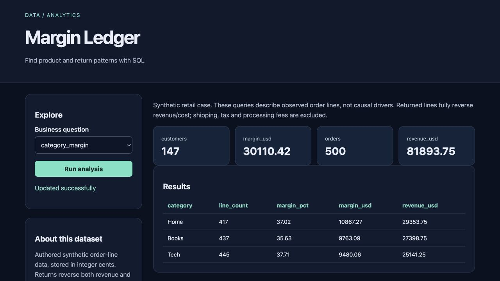

# Margin Ledger

Find product and return patterns with SQL for **retail analysts**.

Original topic: **End-to-End SQL Analytics Project** from [the source post](https://www.instagram.com/p/DdyMaogE4ud/).

> Personal project by Abhijith Viswanathan. Working implementation, reproducible examples and measured results are documented below.



## What works

- Star schema
- 8 queries
- reconciliation
- business report

[Example output](reports/example-output.json) · [Recorded checks](reports/test-results.txt) · [Learning and interview guide](LEARNING_GUIDE.md)

## Start

Python 3.12 is the validated Python runtime. Run commands from this repository directory. Windows users activate `.venv\Scripts\activate` instead of `source`.

```sh
python3.12 -m venv .venv
source .venv/bin/activate
python -m pip install -r requirements.txt
python generate.py
python app.py
```

Open **http://127.0.0.1:8080**. Keep the process running. Set `PORT` to use another port. The Python development servers are intended for local demonstrations.

## Demonstration

Compare category margin, monthly revenue and cumulative revenue. Verify totals agree, then inspect the returns and cohort reports and generated business findings.

## Architecture and decisions

Browser controls → validated Flask API → project analysis/workflow → results and export.

Stack: SQLite · Python · Flask.

1. Keep order-line grain explicit and validate order-level fields before aggregation.
2. Represent money in integer cents and reverse returned lines consistently.
3. Use reusable SQL files, including CTEs and window functions, with cross-report reconciliation tests.

## Verification

```sh
python -m pytest -q
```

See [VERIFICATION.md](VERIFICATION.md) for actual executed checks, setup verification, model/data results and any outstanding environment limitations. The [recorded CI runs](reports/ci-verification.json) passed for the linked source revision.

## Data and attribution

Synthetic retail orders. See [DATA_AND_SOURCES.md](DATA_AND_SOURCES.md) for provenance and usage notes. Original project code is MIT unless a preserved source file or dependency states otherwise. Model and third-party data licenses remain separate.

## Limitations and next improvement

Synthetic six-month retail data. Simplified full-line returns, no shipping/tax/fees, no causal conclusions. Repeat-customer and cohort analyses use only the observed window and may misclassify pre-window customers.

Suggested extension: Add a customer lifetime-value proxy with a clear observation window and no future-value claim.

## Honest portfolio use

AI tools assisted with implementation, tests and documentation. This is my personal portfolio work; benchmark results and deployment boundaries are documented in the repository.

## Connect

[LinkedIn — Abhijith Viswanathan](https://www.linkedin.com/in/abhijith-viswanathan-0a7216436/)
